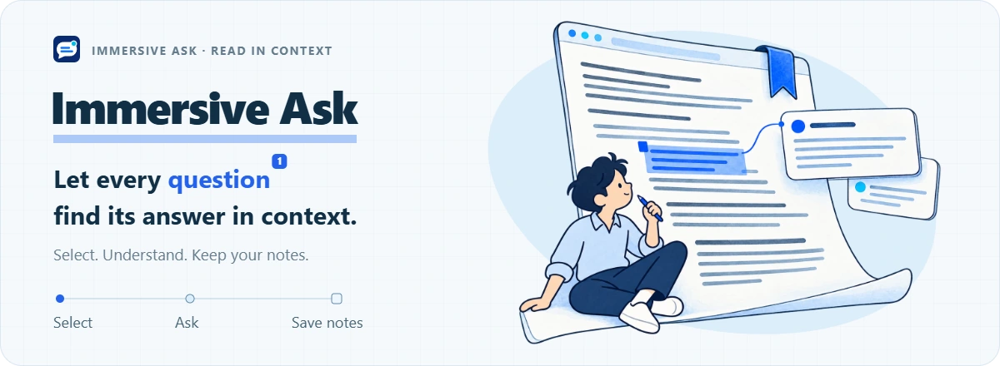
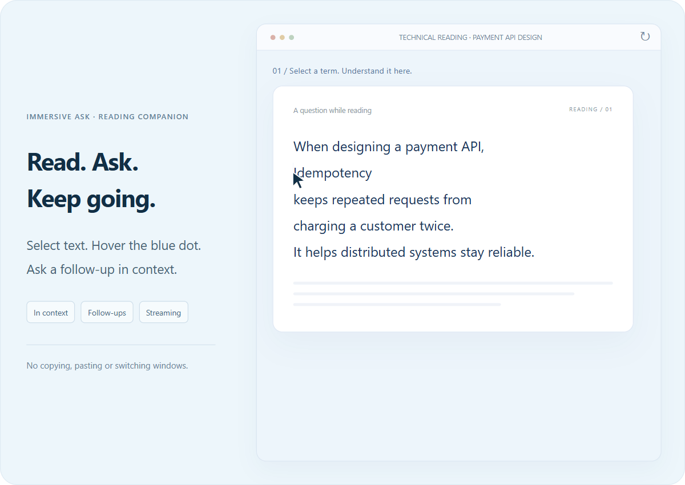
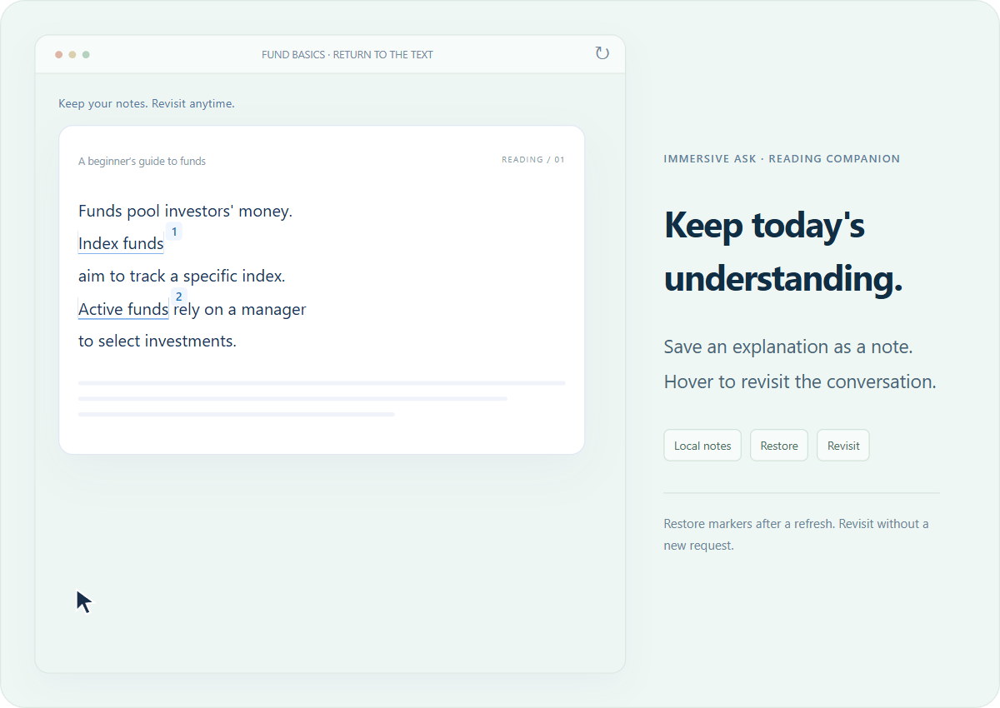

  <a href="https://promptos.cn/">
    <picture>
      <source media="(max-width: 600px)" srcset="docs/assets/en/hero-mobile.webp">
      
    </picture>
  </a>

  Select a word. Understand the passage. 
  Get an AI explanation, ask a follow-up, and keep a note without leaving your reading.

  
  

  <a href="https://promptos.cn/#install-actions"><strong>Download & install ↗</strong></a> &nbsp; · &nbsp;
  <a href="https://promptos.cn/">Website & interactive demos</a> &nbsp; · &nbsp;
  <a href="https://github.com/zhengzhoujiao/immersiveAsk/releases">Releases</a> &nbsp; · &nbsp;
  <a href="https://github.com/zhengzhoujiao/immersiveAsk/issues">Report an issue</a> &nbsp; · &nbsp;
  <a href="README.md">简体中文</a> · <strong>English</strong>

Immersive Ask is a reading companion for **Chrome / Edge**. Select an unfamiliar term or sentence and hover over the blue dot to see an explanation in context, beside the original passage. Ask follow-up questions without copying text or switching to another chat window.

**Read and ask:** select text, hover over the blue dot, then ask a follow-up in context.

**Keep your understanding:** explanations and follow-ups become local annotations. When you revisit a page, the extension tries to restore the markers so you can hover to read your saved conversation.

## Get started

1. **Install the extension:** choose an installation method on the [website](https://promptos.cn/#install-actions). You can also download the latest packages from [Releases](https://github.com/zhengzhoujiao/immersiveAsk/releases/latest). For manual installation, see the [ZIP guide](https://promptos.cn/install/zip) or [CRX guide](https://promptos.cn/install/crx).
2. **Finish setup:** choose your language and enter your DeepSeek API key, or skip this step to use the available free trial.
3. **Open a regular web page:** select a word or sentence and hover over the blue dot to get an explanation and ask follow-up questions.

Refresh pages that were open before installation. Pin the extension to your toolbar to access settings, cache and annotations anytime.

## Languages

The interface and default AI explanations support **Simplified Chinese, Traditional Chinese, English, Japanese, Spanish, Portuguese (Brazil), Korean, German and French**. The extension follows your browser language by default; you can also choose a language in its menu or settings. Custom prompts are used as written.

## Your API key or a free trial

**The extension is free. Explanations, follow-ups, caching and annotations carry no separate extension fee.**

| Start with | Best for | Cost |
| --- | --- | --- |
| Your DeepSeek API key | Ongoing use with your own AI usage management | Extension features are free; DeepSeek bills AI usage at its rates |
| Free trial | Trying explanations and follow-ups | When the service is available and within budget, the default is 3 requests in total, without account registration. Actual quota depends on server configuration and the allowance already issued |

With your own key, explanation requests go directly to DeepSeek. Your key is not sent to the free trial relay. Adjust explanation preferences and context length in settings.

During the trial, initial explanations, follow-ups and regenerated answers use quota when an answer is actually generated. After the quota runs out, you can still revisit local cached answers and annotations, or enter your own key to continue.

→ [Get a DeepSeek API key](https://platform.deepseek.com/api_keys)

## Common questions

<strong>Which pages does it work on?</strong>

Regular web pages in Chrome and Edge. Browser internal pages, extension stores and built-in PDF readers generally cannot be used. Text fields and editable areas do not trigger explanations.

<strong>Will annotations always return when I reopen a page?</strong>

The extension tries to restore annotations using saved passages and nearby text. Major page changes, removed text, cleared extension data or uninstalling the extension can prevent recovery. Local storage also has limits; keep a separate backup of important content.

<strong>Where is my data stored?</strong>

Cached explanations, annotations and saved conversations stay in local browser extension storage and can be cleared in settings. To generate an answer, selected text, necessary context and follow-up questions are sent to DeepSeek, through the relay when using the free trial. The extension also sends anonymous usage statistics to the server.

<strong>No blue dot after selecting text?</strong>

Refresh the page, check the extension's site access and try selecting regular page text. Pages already open when the extension is updated or reloaded also need a refresh.

## Feedback and support

[Open an issue](https://github.com/zhengzhoujiao/immersiveAsk/issues) with your use case, browser version and steps to reproduce the problem.

If the extension helps your reading, consider starring the project or supporting maintenance through “Buy me a coffee” in the extension menu.

This repository provides project information, releases and issue tracking. Project source code is not published. Download installation packages from [GitHub Releases](https://github.com/zhengzhoujiao/immersiveAsk/releases). Third-party dependencies retain their own licenses.

---

  <strong>Next time a word feels unfamiliar, stay right where you are.</strong> 
  <a href="https://promptos.cn/#install-actions">Start reading →</a>

