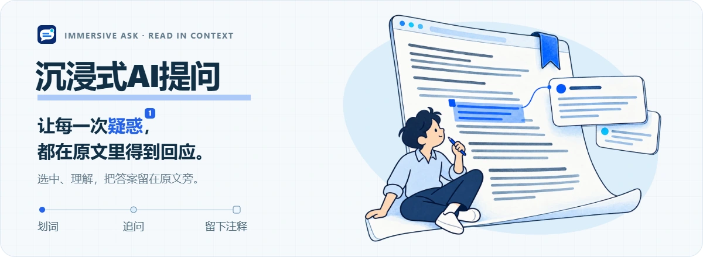
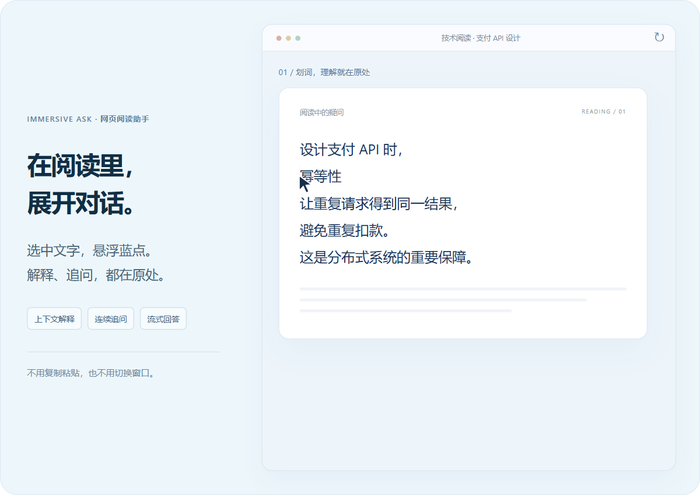
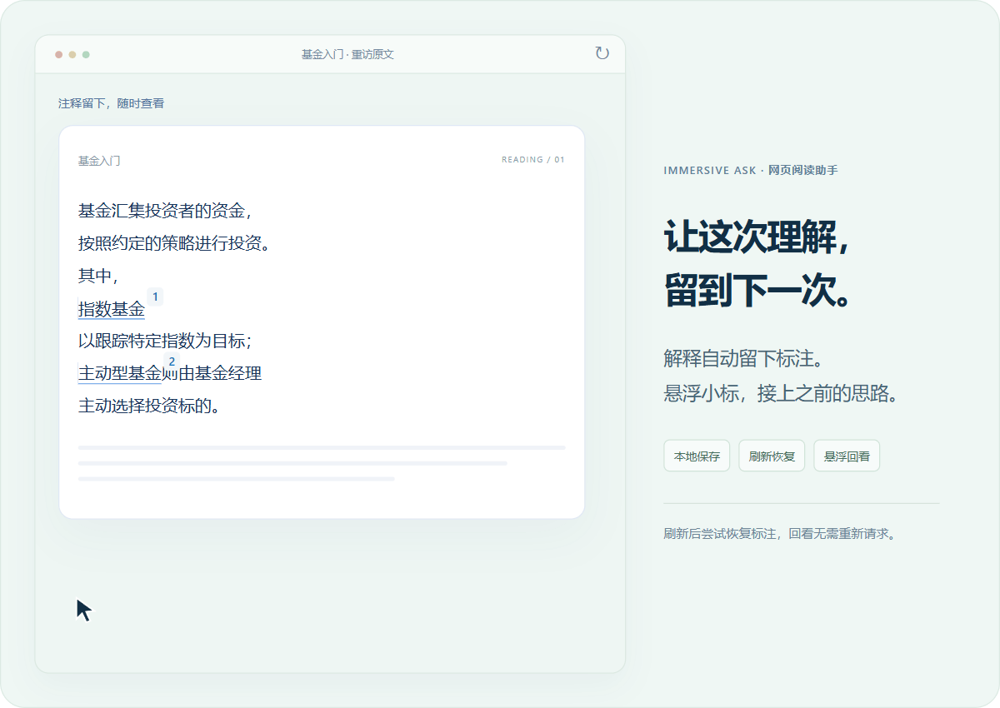

  <a href="https://promptos.cn/">
    <picture>
      <source media="(max-width: 600px)" srcset="docs/assets/hero-mobile.webp">
      
    </picture>
  </a>

  划选一个词，理解一段话。 
  用 AI 解释、接着追问，自动生成注释，让阅读顺着思路继续。

  
  

  <a href="https://promptos.cn/#install-actions"><strong>下载安装 ↗</strong></a> &nbsp; · &nbsp;
  <a href="https://promptos.cn/">官网与交互演示</a> &nbsp; · &nbsp;
  <a href="https://github.com/zhengzhoujiao/immersiveAsk/issues">反馈问题</a> &nbsp; · &nbsp;
  <strong>简体中文</strong> · <a href="README.en.md">English</a>

沉浸式AI提问是一款适用于 **Chrome / Edge** 的网页阅读助手。遇到陌生的术语、难懂的句子，选中文字、悬浮蓝点，就能在原文旁查看结合上下文的解释。不用复制粘贴，也不用切换到另一个聊天窗口。

**在阅读里展开对话**：选中文字、悬浮蓝点，结合上下文查看解释，并继续追问。

**让理解留到下一次**：解释与追问保存在本地，刷新或重访时尝试恢复标注，悬浮小标即可回看。

## 几步开始

1. **安装插件**：前往 [官网](https://promptos.cn/#install-actions) 选择适合自己的安装方式，也可在 [Releases](https://github.com/zhengzhoujiao/immersiveAsk/releases/latest) 下载最新安装包。手动安装可参考 [ZIP 安装指引](https://promptos.cn/install/zip) 或 [CRX 安装指引](https://promptos.cn/install/crx)。
2. **完成引导**：选择阅读语言，填写个人 DeepSeek API Key，或跳过并使用可用的免费体验。
3. **打开普通网页**：划选正文中的词语或句子，将鼠标移到小蓝点上，开始解释与追问。

安装前已经打开的网页，请先刷新。也可以把插件图标固定到浏览器工具栏，随时打开设置、管理缓存与注释。

## 支持语言

界面和默认 AI 解释支持 **简体中文、繁体中文、英语、日语、西班牙语、葡萄牙语（巴西）、韩语、德语和法语**。插件默认跟随浏览器，也可在菜单或设置中手动选择；自定义提示词按原样使用。

## 用自己的 API Key，也可免费体验

**插件本身免费，划词解释、连续追问、缓存和注释功能均不单独收费。**

| 开始方式 | 适合谁 | 费用说明 |
| --- | --- | --- |
| 个人 DeepSeek API Key | 希望持续使用，并自行管理 AI 用量 | 插件功能免费；AI 调用由 DeepSeek 按用量计费 |
| 免费体验 | 想先试试划词解释与追问 | 服务开放且预算可用时，默认提供累计 3 次免费体验，无需注册账号；实际次数以服务端配置及已领取额度为准 |

使用个人 Key 时，解释请求直接发送至 DeepSeek，个人 Key 不发送给免费体验中转服务。你可以在设置中调整解释偏好与上下文字数。

免费体验中，首次解释、追问和重新生成会在实际生成回答时消耗次数。额度用完后，仍可回看已保存的本地缓存与注释，也可以填写自己的 Key 继续使用。

→ [获取 DeepSeek API Key](https://platform.deepseek.com/api_keys)

## 一些你可能关心的事

<strong>可以在哪些页面使用？</strong>

适用于 Chrome 和 Edge 的普通网页。浏览器内部页面、扩展商店和内置 PDF 阅读器通常无法使用；输入框和可编辑区域不会触发划词解释。

<strong>重新打开网页，注释一定能恢复吗？</strong>

插件会根据保存的原文和附近文本尝试恢复。网页大幅改版、原文被删除、清除扩展数据或卸载插件，都可能影响恢复；本地存储也有容量限制，重要内容建议另行备份。

<strong>数据保存在哪里？</strong>

解释缓存、注释和保存的对话保存在浏览器本地扩展存储中，可在设置中清理。生成回答时，选中文字、必要上下文和追问会发送至 DeepSeek；免费体验通过中转服务发送。插件也会向服务端发送匿名使用统计。

<strong>划词后没有出现小蓝点？</strong>

先刷新网页，并确认扩展已获得当前网站的访问权限，再在普通网页正文中试一次。插件更新或重新加载后，已经打开的网页也需要刷新。

## 交流与支持

遇到问题或有想法，欢迎 [提交 Issue](https://github.com/zhengzhoujiao/immersiveAsk/issues)。反馈时附上使用场景、浏览器版本和复现步骤，会更方便定位。

如果它帮到了你的阅读，欢迎给项目一个 Star，或在插件菜单中通过「一杯咖啡」支持后续维护。

此仓库用于项目介绍、版本发布和问题反馈，不包含项目源码。安装包通过 [GitHub Releases](https://github.com/zhengzhoujiao/immersiveAsk/releases) 管理；第三方依赖遵循各自的许可证。

---

  <strong>下一次遇到陌生的词，留在原处就好。</strong> 
  <a href="https://promptos.cn/#install-actions">开始阅读 →</a>

